# pxc-watchdog flowchart

The decision logic of `pxc-watchdog.sh` (`main()`), one run. The timer starts a
new run 15 minutes after the previous one finishes. Every message goes to the
journal with the tag `pxc-watchdog` at the priority shown
(`journalctl -t pxc-watchdog`). Defaults are in parentheses; all of them can be
overridden in `/etc/default/pxc-watchdog`.

```mermaid
flowchart TD
    start(["pxc-watchdog.timer fires<br/>pxc-watchdog.service runs the script"])

    cred{"MYSQL_DEFAULTS_FILE<br/>readable?"}
    lock{"flock -n on LOCK_FILE<br/>acquired?"}

    q1{"mysql: read<br/>wsrep_local_state_comment<br/>succeeds?"}
    j1{"state starts with<br/>Joining?"}

    s1["ss sample 1<br/>local, peer, bytes_received<br/>of each ESTAB socket on<br/>local ports 4444 / 4568"]
    wait["sleep WAIT_SECONDS (180 s)"]

    q2{"mysql query<br/>succeeds?"}
    j2{"state still<br/>Joining?"}
    s2["ss sample 2"]

    prog{"sample 2 not empty<br/>AND different from sample 1?"}
    stuck["STUCK · warning<br/>no connection on 4444/4568, or<br/>no bytes received (e.g. full Recv-Q)"]

    reach{"any DONOR_IPS node<br/>accepts TCP on<br/>GCOMM_PORT (4567)?"}
    cap{"restarts in the last 24 h<br/>fewer than MAX_RESTARTS (4)?"}
    dry{"DRY_RUN = 1?"}
    rec{"record restart in<br/>STATE_DIR/restarts<br/>succeeds?"}

    stop{"systemctl stop<br/>within STOP_TIMEOUT<br/>(300 s)?"}
    kill["err: stop did not finish<br/>systemctl kill -s SIGKILL"]
    stop2{"systemctl stop<br/>within 60 s?"}
    startq{"systemctl start --no-block<br/>SERVICE_NAME<br/>succeeds?"}

    e_cred(["exit 1 · err<br/>cannot read credentials file"])
    e_lock(["exit 0 · info<br/>another run is still active"])
    e_query(["exit 0 · warning<br/>cannot query mysqld"])
    e_notj(["exit 0 · info<br/>state is '...'; nothing to do"])
    e_changed(["exit 0 · notice<br/>state changed during the wait"])
    e_prog(["exit 0 · notice<br/>state transfer in progress"])
    e_link(["exit 0 · warning<br/>no site 1 node reachable;<br/>link is down, not restarting"])
    e_cap(["exit 2 · crit<br/>RESTART CAP REACHED<br/>manual intervention required"])
    e_dry(["exit 0 · notice<br/>DRY_RUN: would restart"])
    e_hist(["exit 1 · err<br/>cannot write restart history;<br/>not restarting"])
    e_nostop(["exit 1 · crit<br/>did not stop; not starting it"])
    e_nostart(["exit 1 · crit<br/>could not start"])
    e_ok(["exit 0 · warning<br/>start queued; node rejoins<br/>(IST/SST) in the background"])

    start --> cred
    cred -- no --> e_cred
    cred -- yes --> lock
    lock -- no --> e_lock
    lock -- yes --> q1
    q1 -- no --> e_query
    q1 -- yes --> j1
    j1 -- "no (Synced, Donor, ...)" --> e_notj
    j1 -- yes --> s1 --> wait --> q2
    q2 -- no --> e_query
    q2 -- yes --> j2
    j2 -- no --> e_changed
    j2 -- yes --> s2 --> prog
    prog -- "yes: bytes arrived or<br/>a new connection opened" --> e_prog
    prog -- no --> stuck --> reach
    reach -- no --> e_link
    reach -- yes --> cap
    cap -- no --> e_cap
    cap -- yes --> dry
    dry -- yes --> e_dry
    dry -- no --> rec
    rec -- no --> e_hist
    rec -- "yes · warning: restarting" --> stop
    stop -- yes --> startq
    stop -- "no (timed out or failed)" --> kill --> stop2
    stop2 -- yes --> startq
    stop2 -- no --> e_nostop
    startq -- yes --> e_ok
    startq -- no --> e_nostart

    classDef idle fill:#e8f5e9,stroke:#2e7d32,color:#1b5e20
    classDef restart fill:#e3f2fd,stroke:#1565c0,color:#0d47a1
    classDef error fill:#ffebee,stroke:#c62828,color:#b71c1c
    classDef alert fill:#fff3e0,stroke:#e65100,color:#bf360c
    classDef warn fill:#fffde7,stroke:#f9a825,color:#5d4037
    class e_lock,e_query,e_notj,e_changed,e_prog,e_link,e_dry idle
    class e_ok restart
    class e_cred,e_hist,e_nostop,e_nostart error
    class e_cap alert
    class stuck,kill warn
```

## Reading it

| Outcome | Colour | Exit | What it means |
| --- | --- | --- | --- |
| Nothing to do | green | 0 | Healthy, transfer progressing, link down, DRY_RUN, or another run active |
| Restart issued | blue | 0 | mysql was stopped and a start was queued; the rejoin continues without the script |
| Restart cap reached | orange | 2 | Stuck with the link up, but 4 restarts already in 24 h; `pxc-watchdog.service` shows as failed |
| Error | red | 1 | Missing credentials, unwritable history, or stop/start failed; needs a look |

Points the chart makes explicit:

- **Unknown means hands off.** The state comes from
  `SHOW GLOBAL STATUS LIKE 'wsrep_local_state_comment'`, run with
  `mysql --defaults-extra-file`. If mysqld cannot be queried (for example during
  an SST, when it refuses client connections), the run ends without action.
- **A connection alone is not progress.** The two `ss` samples must differ.
  `bytes_received` on a socket only grows, so identical samples mean nothing
  arrived, even if the socket is ESTAB with a large Recv-Q.
- **The state is checked twice.** A node that finishes joining during the
  wait is left alone.
- **Reachability before the cap.** Each `DONOR_IPS` node gets a fresh TCP
  connect with a 5 s timeout. While the link is down nothing is restarted and
  nothing alerts. The `crit` only appears when a restart would
  have been possible.
- **The restart is recorded before the stop**, so a crash halfway still counts
  against the cap. Writing the history also drops entries older than 24 h. DRY_RUN stops before this step and writes nothing.
- **`timeout` only kills the `systemctl` client**, so a hung stop is followed
  by `systemctl kill -s SIGKILL` and a second, bounded `systemctl stop` that
  waits for the stop job to finish.
- **`start --no-block`** returns as soon as the start is queued, so a long
  IST/SST does not hold the timer job open.
